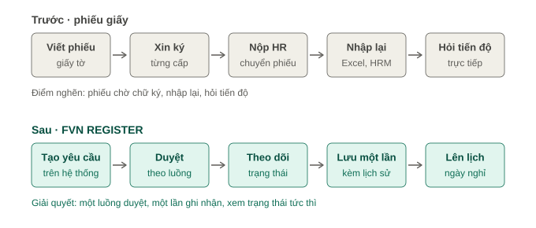
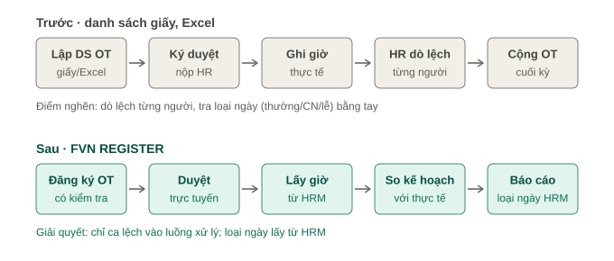
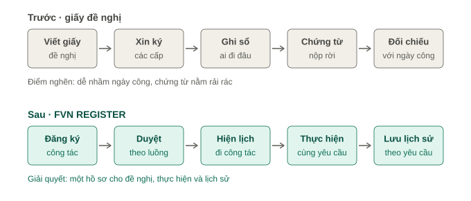
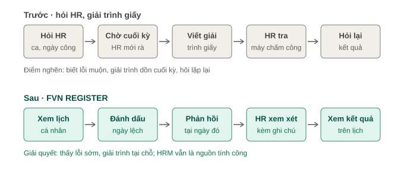
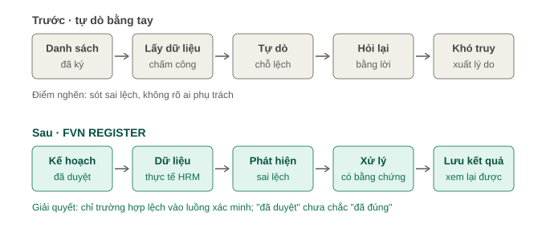
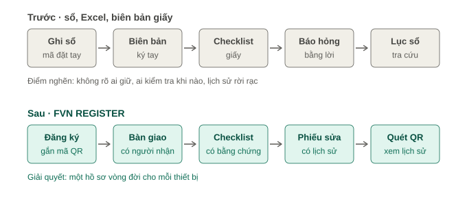
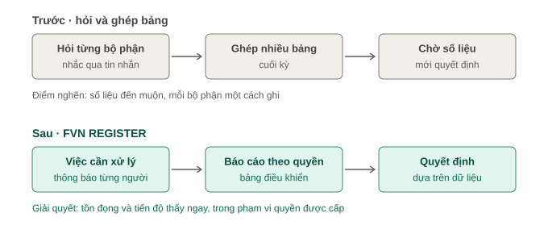

<!-- _class: lead -->

# FVN REGISTER

## Từ xử lý thủ công trên giấy tờ đến quy trình số hóa có thể kiểm soát

**Một nền tảng · Một luồng xử lý · Dữ liệu để cải tiến**

Lịch làm việc & ngày công | Nghỉ phép | OT | Công tác | Thiết bị

> Giảm thao tác lặp lại. Làm rõ trách nhiệm. Đo hiệu quả thực tế.

---

# 01 — BÀI TOÁN KHÔNG CHỈ LÀ GIẤY TỜ

## Một yêu cầu nhân sự thường kéo theo nhiều công đoạn

| Điểm phát sinh | Công việc thủ công                         | Tác động vận hành                    |
| -------------- | ------------------------------------------ | ------------------------------------ |
| Đăng ký        | Lập phiếu, bổ sung thông tin, chuyển hồ sơ | Tốn thời gian của người gửi          |
| Phê duyệt      | Tìm yêu cầu, hỏi tiến độ, nhắc người xử lý | Phát sinh giao dịch và thời gian chờ |
| Tổng hợp       | Nhập lại dữ liệu vào nhiều bảng            | Tăng công sức và nguy cơ sai lệch    |
| Đối chiếu      | Tự tìm chênh lệch giữa kế hoạch và thực tế | Tốn công xác minh, xử lý lại         |
| Tra cứu        | Tìm hồ sơ, hình ảnh và lịch sử ở nhiều nơi | Khó truy xuất và kiểm tra lại        |

> **Chi phí ẩn = xử lý lặp lại + nhập lại + tìm kiếm + nhắc việc + làm lại**
> Đây là các nhóm chi phí cần đo tại nhà máy, **không phải số tiết kiệm đã được xác nhận**.

---

# 02 — BẢN ĐỒ NGHIỆP VỤ: TRƯỚC VÀ SAU

## Mỗi nghiệp vụ nhân sự đang làm gì trên giấy, và phần mềm thay đổi gì

| Nghiệp vụ | TRƯỚC · giấy tờ, Excel | SAU · FVN REGISTER |
| --- | --- | --- |
| **Nghỉ phép** | Phiếu giấy đi xin chữ ký từng cấp, HR nhập lại | Đăng ký, duyệt và theo dõi trạng thái trên một luồng |
| **Làm thêm giờ** | Danh sách OT giấy/Excel, HR dò lại với giờ chấm công | Đăng ký có kiểm tra quy tắc, đối chiếu kế hoạch với thực tế |
| **Công tác** | Giấy đề nghị, chứng từ nộp rời | Đăng ký, duyệt, thực hiện và lịch sử trong một hồ sơ |
| **Lịch & ngày công** | Hỏi HR ca/ngày công; giải trình bằng giấy cuối kỳ | Một lịch cá nhân; ngày bất thường được đánh dấu và phản hồi ngay |
| **Đối soát** | Tự dò chênh lệch giữa danh sách đã duyệt và thực tế | Chỉ trường hợp lệch vào luồng xác minh |
| **Thiết bị** | Sổ/Excel, biên bản và checklist giấy | Mã QR, bàn giao, checklist, sửa chữa, lịch sử |
| **Báo cáo** | Hỏi từng bộ phận, ghép bảng cuối kỳ | Việc cần xử lý, thông báo và báo cáo theo quyền |

*HRM/nguồn chấm công chính thức vẫn là nguồn chuẩn của dữ liệu và quy tắc tính công. Máy tính đầu cuối (Endpoint) là năng lực IT riêng, chỉ công bố vận hành sau thử nghiệm và nghiệm thu.*

---

# 03 — NGHỈ PHÉP

## Workflow trước / sau khi có phần mềm

<!-- XÁC NHẬN với HR: số cấp ký thực tế và nơi lưu phiếu giấy hiện nay -->

> **Đo bằng:** thời gian từ gửi đến quyết định, số lần nhập lại.

---

# 04 — LÀM THÊM GIỜ (OT)

## Workflow trước / sau khi có phần mềm

<!-- XÁC NHẬN với HR: quy trình duyệt OT trước ngày làm và cách tính OT hiện hành -->

> **Đo bằng:** giờ đối chiếu mỗi kỳ, tỷ lệ hồ sơ phải sửa.

---

# 05 — CÔNG TÁC

## Workflow trước / sau khi có phần mềm

<!-- XÁC NHẬN với HR: chứng từ/báo cáo sau công tác hiện nộp cho bộ phận nào -->

> **Đo bằng:** thời gian tìm hồ sơ, số hồ sơ phải bổ sung.

---

# 06 — LỊCH LÀM VIỆC & NGÀY CÔNG

## Workflow trước / sau khi có phần mềm

<!-- XÁC NHẬN với HR: cách nhân viên giải trình quên quẹt thẻ/thiếu giờ ra hiện nay -->

> **Đo bằng:** số câu hỏi tra cứu cho HR, thời gian xử lý một giải trình.

---

# 07 — ĐỐI SOÁT KẾ HOẠCH VÀ THỰC TẾ

## Không đồng nhất "đã phê duyệt" với "đã thực hiện đúng"

> **Đo bằng:** số sai lệch phát hiện, thời gian xử lý một sai lệch. HRM vẫn là nguồn chuẩn của dữ liệu và quy tắc tính công.

---

# 08 — THIẾT BỊ

## Workflow trước / sau khi có phần mềm

<!-- XÁC NHẬN với bộ phận quản lý thiết bị: hình thức sổ sách và biên bản hiện hành -->

> **Đo bằng:** thời gian tìm mã, lịch kiểm tra, bằng chứng.

---

# 09 — CÔNG VIỆC & BÁO CÁO

## Workflow trước / sau khi có phần mềm

> **Đo bằng:** giờ tổng hợp báo cáo mỗi kỳ.

---

# 10 — GIÁ TRỊ CHO TỪNG VAI TRÒ

| Vai trò | Giảm công việc thủ công | Giá trị nhận được |
| --- | --- | --- |
| **Nhân viên** | Hỏi lịch/ca/ngày công từ nhiều nơi; chuyển phiếu và hỏi tình trạng | Một lịch cá nhân để tự theo dõi ngày công, kế hoạch và trạng thái yêu cầu |
| **Người phê duyệt** | Tìm hồ sơ qua nhiều kênh, nhắc lại thông tin | Tập trung yêu cầu cần quyết định |
| **Quản lý bộ phận** | Hỏi từng người, ghép nhiều bảng | Theo dõi tình hình và việc tồn đọng trong phạm vi được cấp |
| **HR** | Trả lời câu hỏi tra cứu lặp lại, nhập liệu, tổng hợp, dò chênh lệch | Giảm tra cứu thủ công; tập trung xác minh ngày công và xử lý ngoại lệ |
| **Quản lý thiết bị** | Tìm mã, lịch kiểm tra, bằng chứng và lịch sử | Tra cứu hồ sơ và nhiệm vụ đã ghi nhận |
| **Ban giám đốc** | Chờ các bộ phận tổng hợp số liệu | Có cơ sở đo hiệu quả và ưu tiên cải tiến |

> **Lợi ích là giảm việc lặp lại và tăng khả năng kiểm soát, không phải xóa bỏ mọi thao tác của con người.**

---

# 11 — HIỆU QUẢ PHẢI ĐƯỢC ĐO

| Chỉ số | Đo trước và sau áp dụng |
| --- | --- |
| **Thời gian xử lý** | Phút lao động thực tế cho mỗi giao dịch |
| **Thao tác lặp lại** | Lượt nhập lại, nhắc việc, tìm hồ sơ và đối chiếu |
| **Thời gian phê duyệt** | Từ lúc gửi đến lúc quyết định; tách riêng thời gian chờ |
| **Chất lượng xử lý** | Tỷ lệ hồ sơ phải sửa, xử lý lại hoặc quá hạn |
| **Báo cáo / truy xuất** | Giờ tổng hợp và thời gian tìm hồ sơ/bằng chứng |
| **Chi phí** | Khoản chi thực tế giảm trừ chi phí triển khai/vận hành |

**Giờ công giải phóng = Số giao dịch × (Phút lao động trước − Phút lao động sau) ÷ 60**

*Giờ công giải phóng là năng lực có thể chuyển sang việc khác, không mặc nhiên là tiết kiệm tiền mặt. Không công bố ROI khi chưa xác nhận số liệu và chi phí.*

---

# 12 — ĐỀ XUẤT: ĐO THỬ, XÁC NHẬN, MỞ RỘNG

| Giai đoạn | Việc cần làm | Kết quả cần có |
| --- | --- | --- |
| **01 · Đo cơ sở** | Ghi khối lượng giao dịch và thời gian xử lý thủ công theo từng workflow "trước" ở các slide 03–09 | Số liệu trước áp dụng |
| **02 · Thử nghiệm** | Chọn nghiệp vụ đã xác nhận sẵn sàng, hướng dẫn người dùng | Phạm vi và cách đo thống nhất |
| **03 · Đo lại** | Dùng cùng định nghĩa KPI và phạm vi so sánh | Kết quả sau áp dụng |
| **04 · Xác nhận** | Bộ phận nghiệp vụ và người phụ trách số liệu kiểm tra | Lợi ích, chi phí và tồn tại đã được xác nhận |
| **05 · Quyết định** | Đánh giá kết quả và phần việc còn thủ công | Duy trì, cải tiến hoặc mở rộng |

---

<!-- _class: lead -->

# FVN REGISTER

## Giảm thao tác lặp lại. Tăng minh bạch. Cải tiến dựa trên dữ liệu.

> Hiệu quả định lượng sẽ được xác nhận bằng kết quả đo trước và sau áp dụng.
