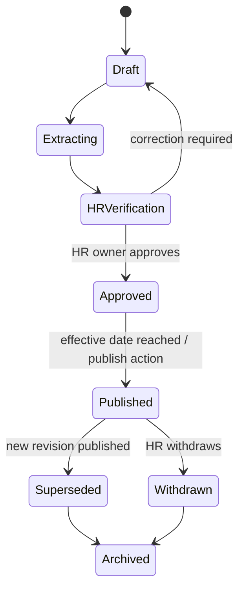
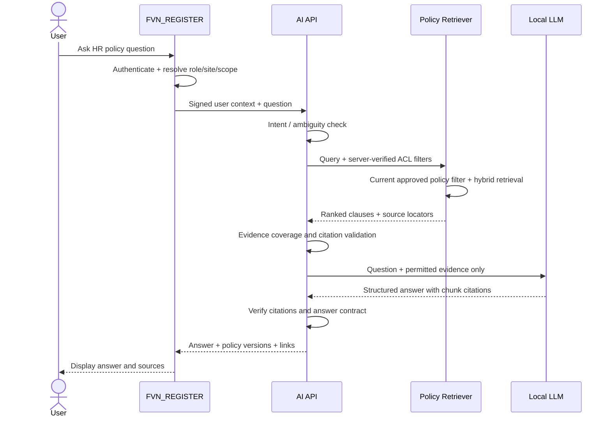

# FVN AI — HR Policy Assistant Design

**Purpose:** Let employees and managers ask natural-language questions about approved HR regulations and procedures, and receive accurate, source-cited answers.  
**Related design:** [AI Platform Architecture](AI_PLATFORM_ARCHITECTURE.md) · [Phase Status](AI_PLATFORM_PHASES_STATUS.md)

## 1. User problem

HR procedures are often distributed across PDF, Word, Excel and internal instructions. Users need quick answers without searching multiple files or repeatedly asking HR.

Example questions:
- “Muốn đăng ký làm thêm giờ thì phải làm thế nào?”
- “Tôi cần đăng ký OT trước bao lâu?”
- “OT vào ngày nghỉ có quy trình khác ngày thường không?”
- “Ai phê duyệt yêu cầu OT của bộ phận tôi?”
- “Nếu giờ OT thực tế khác giờ đăng ký thì cần làm gì?”
- “Quy định nghỉ phép mới nhất ở đâu?”

The assistant answers general policy questions. It does not decide personal eligibility, approve requests, make exceptions or modify business records.

## 2. Key product principle

**Upload is not publication.** A new policy file is a draft source until HR checks its extracted content, metadata, applicability and effective date, then explicitly approves and publishes it.

Normal answers use only approved, published, currently effective versions. Previous versions remain available for audit/history questions but are not mixed into current answers.

## 3. Roles

| Role | Capabilities |
|---|---|
| Employee | Ask questions and view employee-audience published policies |
| Manager / Approver | Ask employee and manager process questions allowed for their scope |
| HR Editor | Upload documents, correct extracted text/metadata, prepare a revision |
| HR Policy Owner / Publisher | Approve, publish, supersede or withdraw policy revisions |
| AI Administrator | Configure providers, index jobs, monitoring and technical controls; cannot approve HR policy content by default |
| Auditor | Read publication history, source versions and answer traces according to permission |

Publishing authority is an HR business permission, not an AI infrastructure administrator privilege.

## 4. Policy lifecycle

Recommended statuses: Draft, Extracting, NeedsCorrection, InReview, Approved, Published, Superseded, Withdrawn, Archived.

Enforce one current published revision per PolicyId and applicable scope/effective window. Where two documents legitimately overlap, policy precedence must be explicit and approved by HR; the AI must not invent a precedence rule.

## 5. Required metadata and governance

Each policy revision must store:

- PolicyId, PolicyCode, Title, Category.
- Version, Status, Language.
- OwnerDepartment, OwnerRole, ApprovedBy, ApprovedAt.
- EffectiveFrom, EffectiveTo, PublishedAt, SupersedesVersion.
- ApplicableEntity, Site, Department (when relevant), Audience.
- Classification, AccessScope, RetentionClass.
- OriginalDocumentId, OriginalFileName, SHA-256, storage key.
- ExtractorVersion, OCRVersion, VerifiedTextVersion and approval audit.

Missing applicability/effective-date metadata is a publication blocker unless HR explicitly records that the rule is organization-wide/perpetual.

## 6. Ingestion and publication

1. HR uploads a PDF, DOCX, XLSX, CSV or supported text file.
2. AI validates format, size, archive limits and scans for malware.
3. Worker extracts text, tables, headings and page/row locations.
4. System proposes title, policy code, version and effective dates where detectable, but marks them as suggestions.
5. HR corrects extracted text and confirms metadata.
6. HR owner approves and publishes.
7. Only then create policy chunks and embeddings.
8. A new revision supersedes the prior one in its applicable scope; retain prior version and audit history.
9. Withdrawal removes the policy from normal retrieval and triggers vector/cache invalidation.

Do not allow model output to change a policy's status or publish it automatically.

## 7. Clause-aware chunking and indexing

Chunk by meaningful structure:
- Policy → chapter → article → clause → subclause.
- Keep heading path and clause number in each chunk.
- Keep table header with corresponding rows.
- Preserve page, paragraph, table, row and source file location.
- Avoid combining unrelated articles just to reach a token target.
- Attach complete policy metadata and ACL scope to every chunk.

Recommended search uses hybrid retrieval:
- lexical/BM25 for exact codes, form names, article numbers and terms;
- vector similarity for paraphrased natural-language questions;
- reranking for relevance;
- metadata filters for current status, effective date, entity/site, audience, language and user permissions.

Proposed provider defaults: Ollama local embeddings/LLM and Qdrant vector store. These are architecture defaults to be configured and tested, not a claim of current running integration.

## 8. Query and answer flow

The AI must not trust role, department, site or employee code sent by browser. FVN_REGISTER signs the context after checking current identity and permissions. ACL filtering happens before model invocation, not merely in the system prompt.

## 9. Answer format

A typical response should be easy to scan:

**Cách thực hiện**
1. Open the relevant FVN_REGISTER feature.
2. Fill in fields required by the applicable approved procedure.
3. Submit for the approval route stated by the policy/workflow.
4. Track status in the application.

The actual steps, deadlines, fields and approvers must be populated from the retrieved FCC policy and live authorized workflow data. The assistant must not assume these values.

**Điều kiện áp dụng:** specify employee group/site/period when supported by source.

**Lưu ý / ngoại lệ:** quote only explicit rules and exceptions.

**Nguồn quy định:** document title, code, version, effective date, article/clause, page and link.

**Trạng thái:** Supported / PartiallySupported / ConflictingSources / NotFound / NeedsHRDecision.

Every factual statement about a rule must cite a retrieved source. The backend validates that citation identifiers correspond to real retrieved chunks and source locations.

## 10. Conflict, missing evidence and escalation

- No current applicable policy: say no approved current rule was found; route to HR policy owner.
- Conflicting active policies: show both sources and do not decide precedence without an approved precedence rule.
- Superseded policy retrieved: exclude from normal answer; show only for explicit historical question with date context.
- Unclear employee/site/audience: ask one clarifying question.
- Personal eligibility, exception, discipline, payroll entitlement or legal interpretation: explain the published process and route the decision to HR.
- Low-quality OCR/table extraction: mark uncertainty and request HR verification; do not cite uncertain text as a confirmed rule.

## 11. Security and privacy

- Employee users can retrieve only published documents for their audience and scope.
- HR drafts and restricted HR procedures are not visible to employees.
- Manager-only rules require manager authorization and applicable scope.
- No employee-specific evidence or case attachment is indexed into the general policy collection.
- Retrieved text is untrusted content; instructions inside documents are never executable.
- Do not send confidential HR content to external providers without explicit approval.
- Audit policy upload, correction, approval, publication, supersession, withdrawal, retrieval sources and user feedback.
- Define conversation retention and minimize personal information in prompts and logs.

## 12. Feedback and quality evaluation

Provide “Helpful / Not helpful” and “Report outdated or incorrect rule”. Capture question intent, source versions, retrieved chunk IDs, citation validation result and user feedback under retention rules.

Build a policy QA set for each approved procedure:
- Direct questions and paraphrases.
- Multi-step process questions.
- Role/site-specific questions.
- Exception and holiday scenarios.
- Questions whose answers are absent from the policy.
- Old vs new revision questions.
- Conflicting-source questions.
- Prompt-injection text embedded in uploaded files.

Release gate: source correctness, citation validity, effective-version correctness, ACL isolation, abstention correctness and Vietnamese/Japanese answer quality must pass before enabling broad employee access.

## 13. Example: overtime policy

Question: “Muốn đăng ký làm thêm giờ thì phải làm thế nào?”

Expected assistant behavior:
1. Determine whether the question concerns a general employee process or manager/HR process; ask if ambiguous.
2. Retrieve the current effective OT procedure for the user's entity/site/audience.
3. Identify exact clauses for registration timing, required fields, approval sequence, weekend/holiday handling and actual-hours reconciliation, if those clauses exist.
4. Explain steps in plain Vietnamese, preserving important conditions.
5. Cite each material rule with policy code/version/article/page.
6. Offer a link to the OT registration function in FVN_REGISTER only if the authenticated application supplies a valid route.
7. If a required rule is not in the approved source, explicitly say it is not stated and provide the HR owner contact.

Until the applicable OT regulation is uploaded and approved, the system must not invent the FCC Vietnam procedure. This document is a product design example, not a statement of current company policy.

## 14. Implementation backlog

| Priority | Deliverable | Acceptance |
|---|---|---|
| P0 | Policy metadata model + migration | Version/scope/effective dates and immutable source lineage |
| P0 | HR policy upload and verification UI | Extracted text and metadata can be corrected |
| P0 | HR approval/publication workflow | Only authorized HR publisher can publish |
| P1 | Clause-aware chunker and embedding worker | Every chunk has exact source locator and ACL metadata |
| P1 | Qdrant + hybrid retrieval adapter | Filters apply before content reaches model |
| P1 | Policy Q&A API with citations | Citation IDs validated; abstention works |
| P1 | Blazor chat UI | Answer, sources, feedback and escalation displayed |
| P2 | Japanese/Vietnamese bilingual retrieval/evaluation | Both language variants return correct policy clauses |
| P2 | Policy change impact and stale-answer invalidation | Superseded chunks/caches excluded from current answers |

## 15. Out of scope

- Automatic publication of policy documents.
- AI deciding personal HR eligibility or exceptions.
- AI approving OT/leave or making payroll/attendance changes.
- Free-form text-to-SQL.
- Indexing all uploaded evidence as shared knowledge.
- Training/fine-tuning a model automatically from employee conversations.
