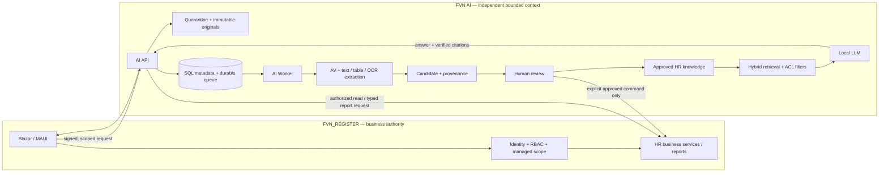
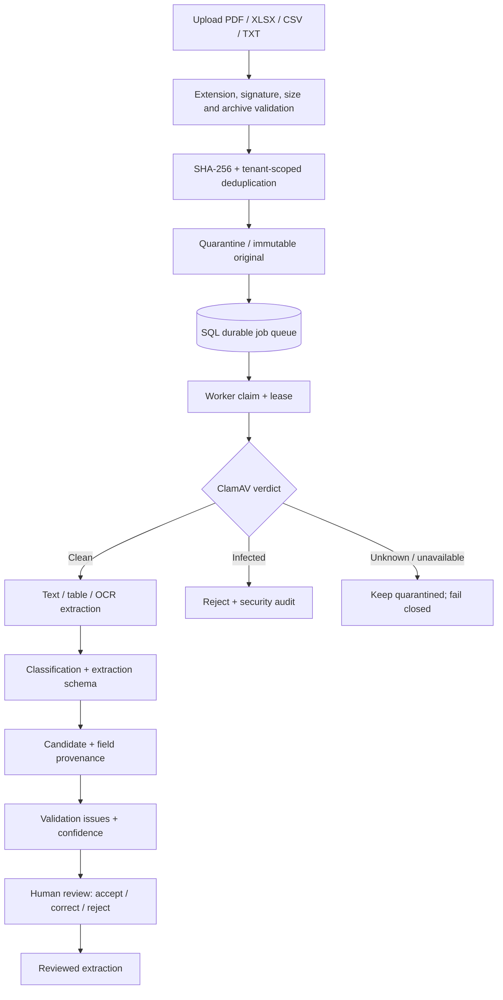
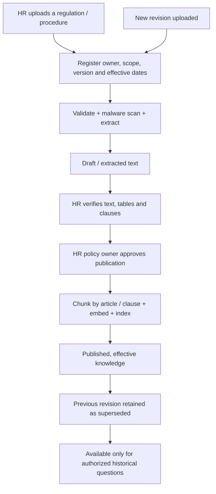

# FVN_REGISTER AI Platform — Architecture & Design

**Version:** 1.1  
**Runtime target:** .NET 9 / SQL Server  
**Deployment:** Hybrid, on-premises first  
**Branch:** `feature/ai-manufacturing-data-platform`  
**Document status:** Current architecture baseline. Implemented capabilities and pending work are distinguished explicitly in [Phase Status](AI_PLATFORM_PHASES_STATUS.md).

## 1. Product vision

FVN AI is a separate, independently deployable AI capability that extends FVN_REGISTER without replacing its business rules or system of record.

The platform has three related product capabilities:

1. **Document intelligence:** ingest evidence, extract structured candidates, preserve provenance and send candidates to human review.
2. **HR Policy Assistant:** answer employee questions about approved HR rules and procedures, such as the overtime registration process, using current controlled policy documents with citations.
3. **HR operations assistant:** analyze employee feedback and evidence against authorized attendance/leave/OT facts; propose explanations and HR replies. A reporting chat interface may translate natural-language questions into existing authorized reports.

FVN_REGISTER remains authoritative for employee identity, permissions, requests, approvals, attendance, leave, OT, trip, equipment and reports.

## 2. Non-negotiable architecture decisions

- AI is a separate bounded context with its own database/schema and deployable API/Worker.
- AI projects must not reference the FVN_REGISTER operational EF DbContext.
- AI does not directly write FVN_REGISTER business tables.
- FVN_REGISTER remains the identity, RBAC, business-validation and command boundary.
- A model-generated candidate, answer or recommendation is not an approved business decision.
- Business changes require an explicit user/HR action, then fresh authorization and domain validation inside FVN_REGISTER.
- No arbitrary model-generated SQL, shell command or script execution.
- Retrieval permissions are enforced before retrieved content enters a model prompt.
- Only HR-approved and effective policy revisions are eligible for normal policy answers.
- Unsupported, stale, conflicting or insufficient evidence results in clarification or escalation, not a plausible guess.

## 3. Context map

## 4. Solution boundaries

| Component | Responsibility |
|---|---|
| `FVN_REGISTER.AI.Core` | AI domain records and lifecycle invariants |
| `FVN_REGISTER.AI.Application` | Use cases, DTOs and provider-neutral ports |
| `FVN_REGISTER.AI.Infrastructure` | SQL, file storage, antivirus, extraction and model adapters |
| `FVN_REGISTER.AI.Api` | Ingestion, status, review, feedback and future policy/chat endpoints |
| `FVN_REGISTER.AI.Worker` | Durable asynchronous ingestion and indexing pipelines |
| FVN_REGISTER | Identity, RBAC, authoritative HR facts, reports, approvals and user experience |

Integration uses versioned HTTP contracts and service-to-service authentication. Tenant, actor and authorization context must be signed by the trusted FVN_REGISTER backend after it has checked the current user's permissions. Browser-supplied actor IDs are never trusted.

## 5. Deployment baseline

### On-premises by default

- SQL Server dedicated AI database.
- Private filesystem/object storage for immutable originals and quarantine (shared path accessible by API and Worker); later replaceable with S3-compatible object storage.
- ClamAV `clamd` service for malware scanning.
- Tesseract plus PDF rasterizer for scanned documents (pending integration).
- Ollama for local LLM and embedding models (provider adapter/configuration pending end-to-end integration).
- Qdrant for vector retrieval (pending adapter and deployment approval).
- Network segmentation; no public exposure of AI API or model endpoints.

### Cloud use

Disabled by default. Any hosted OCR, LLM or embedding service requires data classification, legal/privacy review, approved region, egress control and explicit configuration.

## 6. Document ingestion and extraction pipeline

### Processing rules

1. Validate allowlisted type, signature, size and archive expansion limits.
2. Calculate SHA-256 and deduplicate only within authorized tenant scope.
3. Store original under generated immutable storage key; never execute uploaded content.
4. Persist document metadata and queue job with idempotency.
5. Worker claims a job with owner/lease; use bounded concurrency, retry/backoff and dead-letter.
6. Antivirus must explicitly return Clean before extraction. Unknown and Infected never create candidates.
7. Extract text/tables while preserving page/row/line/region locations.
8. Classify and produce schema-constrained candidate fields. Candidate data is not an official HR record.
9. Validate data and retain field-level provenance, confidence, parser/model/prompt/schema version.
10. Human review corrects or accepts; keep original candidate and all review history.

Current code baseline: TXT/CSV and basic XLSX extraction, SQL queue/Worker path, ClamAV adapter and review persistence have been added. PDF/OCR, robust lease renewal for long jobs, Blazor review UI and full integration verification remain open. See phase status.

## 7. HR Policy Assistant — controlled policy knowledge

This capability is distinct from evidence extraction and HR case reconciliation. Its purpose is to answer general procedural questions using approved internal regulations and work instructions.

### 7.1 Policy document lifecycle

A file upload alone must never publish a policy. A named HR owner verifies extraction, scope, version and effective date and explicitly approves publication. Superseded versions remain auditable but are excluded from normal current-policy answers.

### 7.2 Required policy metadata

| Field | Purpose |
|---|---|
| PolicyId | Stable identity across revisions |
| Title / PolicyType | Human-readable title and policy family (OT, leave, attendance, conduct, etc.) |
| Version | Revision identifier |
| Status | Draft, InReview, Approved, Published, Superseded, Withdrawn |
| EffectiveFrom / EffectiveTo | Validity window |
| ApprovedAt / ApprovedBy | Publication authority |
| OwnerDepartment / OwnerRole | Responsible policy owner |
| ApplicableEntity / Site | Which company/site the rule applies to |
| Audience | All employees, manager, HR, specific role/group |
| Language | Vietnamese/Japanese or other |
| SupersedesPolicyVersion | Version lineage |
| SourceDocumentId / SHA-256 | Original document provenance |
| Retention / Classification | Lifecycle and sensitivity |

Do not infer missing metadata. HR must resolve missing effective dates, scope or conflicting revisions before publication.

### 7.3 Clause-aware indexing

- Preserve document title, heading hierarchy, article/clause number and table headers.
- Split by article/section, not arbitrary character count alone. Keep a short clause and its subclauses together.
- Keep tables with their column headings and row context.
- Store page, paragraph, clause, row and source document identifiers for every chunk.
- Add policy metadata to every chunk: policy ID, version, status, effective dates, entity/site, audience, language, owner and access scope.
- Keep original document and extracted text immutable/versioned; re-index on approved revision.
- Use hybrid search (keyword/BM25 + vector similarity) and reranking; Qdrant is the proposed vector adapter, not yet implemented.
- Apply tenant, entity, site, audience, role and document ACL filters before retrieval results are passed to the LLM.

### 7.4 Question-answer lifecycle

1. Resolve trusted employee identity, site/entity, department and role from FVN_REGISTER.
2. Classify intent: policy lookup, process explanation, personal case, exception request or HR case.
3. Ask a clarification if required context is missing (for example, employee vs manager process, site, date).
4. Search only approved, published, effective policy revisions that the user is allowed to read.
5. Retrieve relevant clauses with surrounding conditions, definitions, exceptions and referenced forms.
6. Rerank and verify the evidence covers the question.
7. Generate a structured answer using only retrieved policy evidence.
8. Validate every citation against the retrieved chunk IDs and source locators.
9. Return concise steps, applicability, exceptions, source/version/effective date and links to exact pages/clauses.
10. If no evidence, conflicting policies or personal eligibility decision is involved, abstain or route to HR owner.

### 7.5 Answer contract

A policy answer should contain:

- **Direct answer:** one short conclusion.
- **Applicable scope:** entity/site/audience and any required assumptions.
- **Procedure:** numbered actions, sequence and responsible roles.
- **Requirements:** forms, data, deadlines and approval route only if the source says so.
- **Exceptions:** explicit source-supported exceptions; otherwise say none were found.
- **Sources:** title, policy ID, version, effective date, article/clause, page and link.
- **Confidence state:** Supported / PartiallySupported / ConflictingSources / NotFound / NeedsHRDecision.
- **Escalation:** policy owner/HR contact when needed.

Every factual rule claim must cite at least one retrieved source. The application verifies that the citation IDs exist in the retrieval result; do not trust free-form citations emitted by the model.

### 7.6 Example: overtime procedure

User: “Muốn đăng ký làm thêm giờ thì phải làm thế nào?”

The assistant should retrieve the currently published OT procedure and explain only what that document supports, for example:

1. Where to open the OT registration function in FVN_REGISTER.
2. Which date, time range, reason and other fields the policy requires.
3. Which manager/approval levels apply to the user's scope, if defined by policy and workflow configuration.
4. Any submission cutoff or special holiday/weekend rule, if explicitly stated.
5. How to view approval status and what to do when actual OT differs from the registration.

The example is an answer shape, not a statement of FCC Vietnam's actual OT rules. Until HR uploads and approves the applicable OT policy, the assistant must say it cannot confirm the exact procedure and direct the user to HR.

## 8. HR feedback evidence and reconciliation assistant

This is a separate workflow from general policy Q&A.

- User submits a feedback message and evidence.
- AI extracts employee/date/time/value candidates with source locations.
- Trusted FVN_REGISTER service obtains only authorized official facts.
- Deterministic, versioned rules compare registration, approval, actual attendance and relevant calendar/shift context.
- LLM explains differences and drafts a suggested HR reply with evidence citations.
- HR reviews and approves the reply.
- Any correction is executed only through an existing FVN_REGISTER command after fresh RBAC and domain validation.

Initial entities identified for OT/attendance/leave pilot include `F03OTRequests`, `F03OTEmployees`, `F03AttendanceStaging` and `F03LeaveDays`. The AI service never connects directly to the operational DbContext.

See [AI HR Reconciliation Pilot](AI_HR_RECONCILIATION_PILOT.md).

## 9. HR reporting chatbot

Natural language is an alternative interface to existing reports, not an alternative authorization system.

- Map questions to an allowlisted report intent (attendance, leave, OT, trip, equipment).
- Parse dates, department, employee and grouping into typed parameters.
- FVN_REGISTER validates employee identity, report permission and managed scope before executing a report.
- AI summarizes returned authorized data and explains trends; it does not generate arbitrary SQL.
- Every numeric result shows period, scope, filters and underlying report reference.
- Ask a clarification when time range or scope is ambiguous.

## 10. SQL, object and vector data boundaries

AI database stores document/job/extraction/review/feedback/policy/chunk/index metadata and audit. Original files are stored separately. Vector index stores embeddings and metadata references, not authoritative HR facts.

Suggested logical entities:

- AiDocument, AiIngestionJob, AiExtraction, AiValidationIssue, AiReview, AiFeedback.
- AiPolicy, AiPolicyVersion, AiPolicyApproval, AiPolicyChunk, AiPolicyIndexJob.
- AiConversation, AiConversationTurn, AiRetrievalTrace, AiCitation, AiAnswerFeedback.
- AiKnowledgeChunk and AiModelDeployment.

Policy revision and chunk records must retain lineage to original file hash, approval record and source locator. Deletion/retention must propagate to originals, SQL, vector index, caches and backups according to approved retention rules.

## 11. Security, privacy and governance

- Use FVN_REGISTER identity and RBAC as the authority; sign service-to-service user context server-side.
- Apply document ACL filters before vector search and before model context assembly.
- Separate employee-visible policies from HR-only drafts, investigation records, payroll details and restricted case evidence.
- Do not make individual feedback attachments globally searchable knowledge.
- Treat uploaded files, OCR text and retrieved policy content as untrusted data; ignore instructions embedded in source documents.
- Never send a user's data to an external model by default.
- Minimize query and response logging; define retention and access for conversation traces.
- Do not expose one employee's case or personal data to another employee.
- Keep immutable audit of policy publication, supersession, retrieval source versions and HR review actions.

## 12. Observability and evaluation

Evaluate separately:

- Extraction accuracy by document type and field.
- Classification accuracy and confidence calibration.
- Retrieval recall for approved clauses.
- Citation validity and citation-to-claim support.
- Answer groundedness, completeness and correct abstention.
- Policy freshness after revision/supersession.
- ACL isolation and negative permission tests.
- Latency, queue age, provider failures and per-request resource use.

Build a Vietnamese/Japanese golden question set from HR-approved procedures. Include ambiguous questions, superseded policies, conflicting rules, site-specific rules, no-answer cases and prompt-injection documents. Do not promote a model/prompt/index revision until regression tests pass.

## 13. Delivery roadmap and exit gates

| Order | Work package | Exit gate |
|---|---|---|
| A | Verify ingestion Worker + SQL migrations + ClamAV deployment | Clean/Unknown/Infected tests, idempotency and retry pass |
| B | Finish PDF/OCR, Ollama extraction and review UI | Real evidence reaches HR review with provenance |
| C | HR Policy Admin: upload, metadata, versioning, approval and publication | HR can safely publish and supersede a procedure |
| D | HR Policy Assistant RAG | Answers cite current approved clauses and abstain correctly |
| E | OT/attendance feedback reconciliation | Deterministic comparisons + HR-reviewed suggested reply |
| F | HR reporting chatbot | Natural language invokes only authorized report contracts |
| G | Broader RAG and analytics | ACL, quality, security and operational gates pass |

RAG should begin after document extraction/review and policy governance are reliable. Do not index all uploaded documents indiscriminately.

## 14. Current implementation boundary

This document describes the target design, not a claim that every component is implemented. The actual code status is tracked in [AI Platform Phase Status](AI_PLATFORM_PHASES_STATUS.md). Current branch includes AI projects, upload/validation/storage/SQL queue foundations, a Worker pipeline baseline, ClamAV adapter, local TXT/CSV/basic XLSX extraction, candidate/review/feedback persistence and API endpoints. Real deployment configuration, end-to-end build/test evidence, OCR, LLM extraction integration, review UI, policy administration, Qdrant retrieval and chatbot UI remain outstanding.
