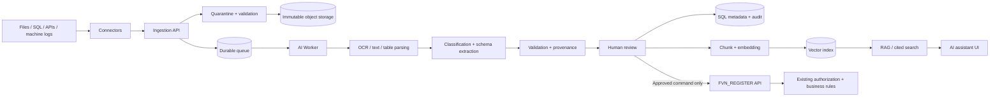

# FVN_REGISTER AI Platform — Architecture baseline

**Status:** architecture baseline and buildable scaffold | **Runtime:** .NET 9 | **Deployment:** hybrid

## 1. Decision

AI is a separate bounded context and independently deployable service. FVN_REGISTER remains the system of record for employee, approval, equipment, attendance, leave, overtime, trip and operational data.

AI may ingest, classify, extract, index, search and recommend. It must not silently create or overwrite official business records. Any business write requires an explicit human-approved command, followed by authorization and domain-rule validation inside FVN_REGISTER.

## 2. Context map

## 3. Project boundaries

| Project | Responsibility |
|---|---|
| `FVN_REGISTER.AI.Core` | AI domain entities, lifecycle and invariants |
| `FVN_REGISTER.AI.Application` | Use cases, provider-neutral ports, DTOs |
| `FVN_REGISTER.AI.Infrastructure` | SQL/object/vector/queue/provider adapters |
| `FVN_REGISTER.AI.Api` | AI ingress, query and review endpoints |
| `FVN_REGISTER.AI.Worker` | Durable asynchronous pipelines |
| FVN_REGISTER | Business system of record, authorization and user experience |

Do not reference FVN_REGISTER EF DbContext from AI projects. Integrate through versioned HTTP contracts and service-to-service identity. Do not put provider SDKs into existing FVN_REGISTER projects.

## 4. Hybrid runtime

- **On-premises:** source connectors, quarantine, original documents, SQL metadata/audit, queue and local OCR/LLM/embedding runtimes.
- **Cloud (opt-in):** hosted model/OCR/embedding APIs only after data classification, contract, data region and egress policy approval.
- **Provider-neutral ports:** `IAIModelProvider`, `IDocumentTextExtractor`, `IEmbeddingGenerator`, `IVectorKnowledgeStore`.
- **Safe default:** `UnconfiguredAIModelProvider` fails explicitly; it never returns fabricated AI output.

## 5. Data lifecycle

1. Register source identity, tenant/department, owner, retention class and source reference.
2. Quarantine; enforce size, extension, MIME and file-signature checks, malware scan and archive-bomb limits. Never execute uploaded content.
3. Store original under immutable object key; calculate SHA-256; deduplicate within permitted tenant scope.
4. Persist idempotent job/outbox before acknowledging ingestion; retry with backoff and dead-letter poison jobs.
5. Extract text/tables/OCR with page and bounding-box provenance; classify document and select versioned schema.
6. Extract typed candidate fields with confidence, source page/region, parser/model/prompt/schema versions.
7. Validate syntax, schema, master-data references, cross-field rules and duplicates.
8. Human review for low confidence, sensitive data or business-impacting action; retain before/after correction.
9. Index only approved knowledge chunks with ACL/tenant metadata.
10. Retrieve only after authorization filtering; cite source document/page/chunk; refuse unsupported answers.
11. For business integration, user approves a command and FVN_REGISTER re-checks permissions and domain invariants.

## 6. Capability modules

### Universal ingestion
Start with manual upload, Excel, CSV, TXT and PDF. Extend through connector contracts to scanned images, SharePoint, read-only SQL views, REST, SFTP and machine logs. Each connector needs checkpointing, source identity, idempotency and retry.

### Document understanding
Validation → text/table extraction → language detection → classification → schema detection → structured extraction. Support Vietnamese and Japanese; retain original text and page/region coordinates.

### Structured extraction and validation
Store candidates separately from business tables. LLM output is untrusted until strict schema and business validation pass. Each field retains confidence and provenance.

### Knowledge base / RAG
Originals in object storage; document/job/review metadata in SQL Server; vectors behind `IVectorKnowledgeStore`. Select an approved on-prem vector service or compatible SQL vector capability only after confirming deployed SQL Server version. ACL and tenant filters must be applied before context reaches a model. Answers include citations.

### Feedback / active learning
Capture accept/reject/correct, reviewer, reason, before/after payload and parser/model/prompt version. Use feedback first for schema/rule improvements, golden evaluation sets and regression tests. Fine-tuning is a separately approved, evaluated and reversible release—not automatic training after each edit.

## 7. Logical data model

- `AiSource`: connector, source key, tenant/department, checkpoint and access scope.
- `AiDocument`: immutable file metadata, hash, object key, classification and lifecycle.
- `AiProcessingJob`: pipeline version, idempotency key, attempts, status, timings and failure code.
- `AiExtraction`: candidate payload, confidence, provenance and model/schema versions.
- `AiValidationIssue`: rule, severity, field path and explanation.
- `AiReview`: reviewer decision, correction and audit.
- `AiKnowledgeChunk`: document/page/section, ACL metadata, content hash and embedding reference.
- `AiFeedback`: normalized feedback for evaluation and improvement.
- `AiModelDeployment`: provider/model/config version, permitted data classes and rollout state.

Deletion, retention and legal hold must propagate across SQL, originals, chunks, vectors and backups.

## 8. Security and governance

- Reuse FVN_REGISTER identity as identity source, but never trust client-supplied user IDs. Use service identity and signed user/authorization context.
- Authorize upload, document read, review, search and export separately; least privilege for connector accounts.
- Store secrets in secret storage/environment configuration; never commit credentials or put keys in browser code.
- External provider use defaults to disabled; enforce data-classification allowlists and egress controls.
- Encrypt transport/storage; redact logs; audit all access and AI actions.
- Treat files, OCR text, retrieved chunks and model output as untrusted; defend against prompt injection and data exfiltration.
- Enforce quotas, rate limits, retention, deletion and malware scanning.
- Never execute model-generated SQL, scripts or commands.

## 9. Target integration API (not all implemented yet)

- `POST /api/ai/v1/documents` — submit file/source reference.
- `GET /api/ai/v1/jobs/{jobId}` — status.
- `GET /api/ai/v1/documents/{documentId}/extraction` — candidate + provenance.
- `POST /api/ai/v1/reviews/{documentId}` — accept/reject/correct.
- `POST /api/ai/v1/search` — ACL-filtered RAG.
- `POST /api/ai/v1/actions/{actionId}/approve` — explicit business command.

FVN_REGISTER remains the only writer to FVN business tables.

## 10. Delivery plan

| Phase | Deliverable | Exit gate |
|---|---|---|
| 0 Foundation | Projects, ports, settings, health/capability | Solution builds; old workflows unchanged |
| 1 Ingestion | Upload, quarantine, object storage, SQL metadata, durable queue | Idempotency, validation, audit, retry |
| 2 Understanding | Excel/CSV/TXT/PDF, OCR, classifier, extraction | Golden set, confidence and provenance |
| 3 Review | Validation rules, correction UI, approved command | Existing FVN authorization re-check |
| 4 RAG | Chunking, embeddings, vector index, cited search | ACL and retrieval evaluation |
| 5 Feedback | Feedback analytics, model registry, monitoring | Versioned rollout, regression and rollback |

## 11. Scaffold boundary

This baseline adds project boundaries, domain lifecycle, provider-neutral ports, safe unconfigured provider, API health/capability endpoint and idle worker host. It does not yet provide a real OCR/LLM provider, upload endpoint, SQL migrations, object store, durable queue, vector database, authentication policy or Blazor review UI. Do not expose the API publicly until those controls are implemented.
