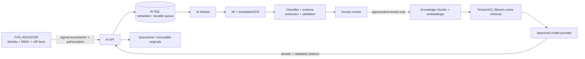

# FVN_REGISTER AI Platform — Current Architecture

**Version:** 1.2  
**Runtime target:** .NET 9 / SQL Server  
**Deployment:** Hybrid, on-premises first  
**Branch:** `feature/ai-platform-phase1-6-integration`  
**Status:** Current architecture baseline. Phase readiness is tracked only in the root `AI_PLATFORM_PHASES_STATUS.md`.

## 1. Boundary

FVN_REGISTER AI is a separate bounded context. It owns AI documents, durable ingestion jobs, extraction candidates, validation, human review, feedback, knowledge chunks and model-release metadata. FVN_REGISTER remains authoritative for identity, RBAC, managed scope, approvals, HR facts and business writes.

No AI model output is an official business decision. Business changes require an explicit FVN_REGISTER command followed by fresh authorization and domain validation.

## 2. Runtime topology



Current retrieval first obtains ACL-filtered vector candidates using cosine similarity, then applies a lightweight lexical token-overlap rerank. This is not a full BM25 index or a production-grade hybrid search engine; any replacement requires benchmark and recall gates.

## 3. Security boundaries

- Tenant and actor context is signed server-to-server; browser actor IDs are not trusted.
- `RequireContentBoundSignatures` defaults to `true`; infrastructure registration refuses startup when it is explicitly disabled.
- Request signatures bind method/path/query/body when content-bound signatures are enabled.
- Replay nonces are retained for at least 10 minutes to cover the ±5-minute timestamp window.
- Review, schema-management, knowledge ACL and AI-platform administration use trusted FVN_REGISTER authorization adapters and fail closed when absent.
- RAG retrieves only tenant-matching, ACL-authorized chunks tied to an approved/corrected review.
- Evidence text is untrusted data; model prompts explicitly prohibit treating document instructions as commands.

## 4. Document lifecycle

```text
Upload -> validate + SHA-256 -> quarantine -> durable queue -> leased worker
      -> malware scan -> extraction/classification -> schema validation
      -> human review
           -> Approved / Corrected -> eligible for knowledge publication
           -> Rejected             -> purgeable and dedup key released
      -> retention expiry
           -> original deleted
           -> knowledge chunks deactivated and content/embedding removed
           -> extraction candidate/representation removed
           -> document Archived
```

A dead-lettered job now marks its document `Failed`. Re-upload of an identical active fingerprint is idempotent; a dead-letter/failed job can be requeued, while archived/rejected records no longer block a new upload.

## 5. Phase 5 release/provenance model

Every extraction records the provider/model actually used by the classifier, its prompt version, schema version and matching release when one exists. Feedback inherits the extraction's release. Golden evaluations carry `ReleaseId`, and release-gate summaries filter by that release.

Extraction uniqueness is release-aware: `(DocumentId, SchemaVersion, ModelProvider, ModelVersion, PromptVersion)`, with a separate guard for `SchemaVersion IS NULL`. This permits the same document/schema to be evaluated again with a different model/prompt release.

Human-corrected publication uses `CorrectedPayloadJson` rather than silently re-indexing the original candidate text.

## 6. Knowledge retrieval baseline

- Chunks are 6,000 characters with a 500-character overlap.
- Embedding generation is bounded to eight concurrent calls instead of one call per chunk serially.
- Publication is limited to 1,000 chunks per document.
- Retrieval applies tenant and ACL filters before materializing candidates in memory.
- Retrieval is designed for a configurable candidate scan limit (default 5,000) and minimum cosine score (default 0.05). The current SQL store remains the PoC baseline. ACL-filtered candidate materialization is capped at 5,000 rows per query; benchmark evidence is still required before production scale.
- SQL Server 2025 native `VECTOR`/`VECTOR_SEARCH` is a future optimization path; the current implementation remains JSON embeddings plus application cosine scoring.

## 7. Retention and recovery

Retention is coordinated across original storage, document state, extraction payloads and knowledge chunks. Expired `Rejected` documents are purgeable as well as normal documents. Knowledge chunks are deactivated and their content/embedding cleared so expired material cannot remain searchable.

The SQL queue records lease ownership, retry/dead-letter state and document state together. Lease expiry and terminal dead-letter are covered by SQL integration tests.

## 8. Source of truth

- **Phase readiness:** `../AI_PLATFORM_PHASES_STATUS.md`
- **Operations:** `AI_PLATFORM_OPERATIONS.md`
- **Migrations:** `../SQL/AI/001_*.sql` through `022_DropLegacyDocumentFingerprintIndex.sql`
- **CI:** `.github/workflows/ai-platform-sql-validation.yml`

This document must not describe planned hybrid retrieval, real authorization adapters, or complete policy lifecycle as already implemented.
